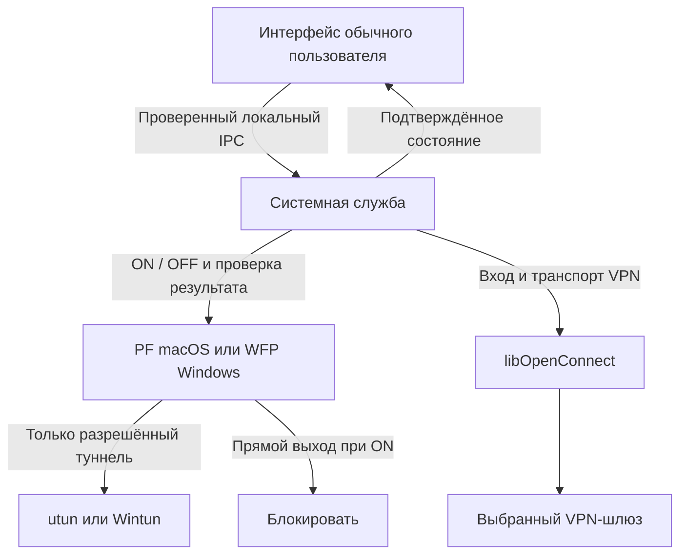

# Как работает kill switch и как восстановить сеть

Kill switch — отдельная системная блокировка обычного сетевого трафика.
Переключатель **«Блокировать интернет без VPN»** управляет блокировкой,
а **Connect / Disconnect** — VPN-соединением. Чтобы вернуть обычную сеть,
нужно явно выключить блокировку. Само отключение VPN её не снимает.

Это руководство описывает реализацию проекта, включая исправления ветки аудита.
Изменение исходников не обновляет установленную службу автоматически.
Результаты и границы проверки: [аудит безопасности](network-security-review.ru.md).

## Что происходит при каждом действии

| Действие / событие | Результат |
| --- | --- |
| Первая установка | Защита выключена; обычная сеть доступна |
| Включить переключатель без VPN | Интернет и обычный доступ в LAN заблокированы на устройстве |
| Нажать Connect при включённой защите | Служба разрешает собственное соединение с выбранным VPN-шлюзом и начинает вход |
| VPN подключён | Разрешён трафик через точный интерфейс этого VPN; прямой выход остаётся закрытым |
| VPN оборвался / Disconnect | Разрешение туннеля убирается; блокировка остаётся |
| Закрыть GUI после подключения | Служба, VPN и выбранная блокировка продолжают работать |
| Закрыть GUI до завершения входа | Незавершённая попытка отменяется; выбранная блокировка сохраняется |
| Выключить переключатель / нажать «Снять блокировку OpenConnect» | Снимаются собственные правила; обычная сеть снова разрешена этой программой |
| Другой firewall продолжает запрещать сеть | Выключение OpenConnect его правила не отменяет |
| Перезапустить службу при сохранённом ON | Служба восстанавливает блокировку; устаревший туннель повторно не разрешается |

«Всё заблокировано» здесь означает обычный IP-трафик приложений, включая IPv4,
IPv6, DNS и LAN. Для работы сетевого подключения остаются узкие служебные
исключения: loopback, DHCP, обнаружение соседей IPv6 и соединение самого VPN.
Это не физическое отключение Wi-Fi/Ethernet и не запрет всех Ethernet-кадров.

## Разделение интерфейса и службы



GUI не получает права root/SYSTEM. Служба имеет эти права для создания туннеля,
маршрутов и сетевых фильтров. Она проверяет пользователя локального канала;
GUI также проверяет подлинность службы. Пароль VPN вводится в GUI и передаётся
ответом на конкретный запрос авторизации. Произвольные команды, скрипты,
пути к файлам и сохранённые пароли из профиля через этот канал не принимаются.

Доступ разрешён выбранной при установке учётной записи и администратору.
Другие процессы той же учётной записи также входят в эту границу доверия:
отдельного пароля на OFF сейчас нет. Это сетевой предохранитель пользователя,
а не защита от администратора или вредоносного ПО с его правами.

## Путь подключения при включённой блокировке

1. Служба проверяет HTTPS-адрес и протокол выбранного профиля. Можно использовать
   любой совместимый шлюз; адрес организации в приложение не встроен.
2. Для доменного имени получает A/AAAA. При необходимости ненадолго открывает
   DNS только привилегированному процессу к настроенным системным резолверам.
   Общего разрешения DNS для браузеров и других приложений нет.
3. Закрывает временное DNS-исключение и закрепляет полученные числовые адреса
   и порты VPN. Запрос имени шлюза при этом может быть виден DNS-серверу.
   Проверка TLS-сертификата и имени сервера остаётся обязательной.
4. libOpenConnect устанавливает TLS и запрашивает логин, пароль или другие
   поддерживаемые сервером формы. Ввод не считается успешным до ответа сервера.
5. После авторизации служба создаёт utun на macOS или Wintun на Windows,
   применяет маршруты/DNS от сервера и проверяет интерфейс с назначенным адресом.
6. Фильтры разрешают только этот интерфейс и адрес. Согласованные DTLS-порты
   и перенаправления разрешаются на время текущего сеанса.
7. После отключения разрешение туннеля и временных адресов удаляется.
   При сохранённом ON общая блокировка остаётся.

Если сервер выдаёт только маршруты к корпоративной сети, остальной интернет
при ON может остаться недоступным даже после входа. Для выхода всего интернета
через VPN нужны соответствующие маршруты и разрешения на сервере. Kill switch
сам по себе не превращает split tunnel в full tunnel.

Ожидание сервера: 30 секунд; ответа после формы входа: 90; подготовки туннеля:
60. На пользовательский ввод отводится 120 секунд. Тайм-аут не доказывает,
что сервер принял пароль. **Cancel** отменяет вход, а не снимает блокировку.

## Что именно делает macOS

- Служба LaunchDaemon: `net.openconnect-vpn.killswitch.service`, пользователь root.
- Собственный раздел правил PF: `com.apple/000.openconnect-gui-killswitch`.
- Разрешения: loopback и служебная настройка сети; root к IP/портам VPN;
  точный utun с назначенными VPN-адресами. Затем — общая блокировка `quick`.
- Исключение шлюза в PF ограничено UID 0, а не конкретным исполняемым файлом.
  Остальные root-процессы имеют то же узкое разрешение к этим IP/портам.
- Несовместимые уже установленные соединения отбираются и закрываются.
  Глобального `pfctl -F states` нет.
- Служба проверяет наличие правил и порядок разделов PF. При опасных чужих
  обходах она сообщает неподтверждённую защиту, а не показывает ложный ON.
- OFF очищает только собственный раздел, проверяет его пустоту, сохраняет OFF
  и освобождает только собственную известную ссылку включения PF.

**PF может оставаться включённым после OFF. Это нормально:** он используется
macOS и другими программами. Проверять нужно собственный раздел и подтверждённый
OFF, а не только общий статус PF.

Состояние хранится в защищённых файлах `boot.json` в
`/Library/Application Support/OpenConnect-GUI-KillSwitch` и `state.json` в
`/var/run/openconnect-gui-killswitch`. В них нет VPN-пароля; там есть адреса шлюза,
намерение ON/OFF и информация восстановления. Их не нужно редактировать вручную.
Исправление аудита сохраняет повреждённые файлы как `.corrupt.XXXXXX`, снимает
собственные правила и записывает пригодное OFF. Неизвестную ссылку PF оно
не угадывает и не освобождает.

## Что именно делает Windows

- Служба SCM: `OpenConnectKillSwitch`, пользователь LocalSystem.
- Собственный provider/sublayer Windows Filtering Platform, без сброса Windows Firewall.
- Четыре постоянных фильтра ALE закрывают исходящие и инициируемые извне
  соединения IPv4/IPv6.
- Исключение шлюза проверяет IP/порт, App ID установленного процесса и SID SYSTEM.
- Разрешение туннеля проверяет точный LUID интерфейса и локальный VPN-адрес.
- Разрешения шлюза/туннеля динамические: при завершении службы они исчезают.
  Блокирующие фильтры постоянные и остаются до явного OFF.
- Изменения выполняются транзакциями; существующие соединения проходят
  повторную проверку ALE. Общего сброса соединений нет.
- Состояние и служебный журнал находятся в
  `%ProgramData%\OpenConnect-GUI-KillSwitch`, доступ к записи ограничен.

Для временного DNS действует общий бюджет 2500 мс, включая TCP fallback.
Исправление аудита не даёт повторным усечённым DNS-ответам продлевать этот бюджет.

## Выключение вручную: macOS

Обычный способ — переключатель или **«Снять блокировку OpenConnect»**.
Без GUI, от той же учётной записи:

```sh
'/Applications/OpenConnect-GUI-KillSwitch.app/Contents/MacOS/OpenConnect-GUI-KillSwitch' --service-disable
```

Успех — строка `PASS: OpenConnect blocking is OFF...` и код завершения 0.
Команда ждёт подтверждения, что служба сохранила OFF и собственные правила сняты.
Сразу после неё проверить код можно командой `echo $?`.

Если служба недоступна, выполните установленный сценарий восстановления:

```sh
sudo /bin/sh '/Library/Application Support/OpenConnect-GUI-KillSwitch/recover-killswitch.sh'
```

Пароль macOS вводится только локально. Альтернатива — открыть
`Recover Kill Switch.command` из DMG. При повреждённых JSON старый установленный
скрипт может завершиться ошибкой; используйте исправленный `scripts/recover-killswitch.sh`
из этой ветки, запустив его из каталога проекта:

```sh
sudo /bin/sh scripts/recover-killswitch.sh
```

Сценарий останавливает собственную службу и незавершённые операции, сохраняет
OFF, очищает только свой раздел PF, проверяет результат и освобождает известную
собственную ссылку PF. Затем возвращает службу управления, если она установлена.
Профили сохраняются. При ошибке записи OFF служба остаётся остановленной,
а сценарий сообщает ошибку вместо ложного успеха.

Проверки без изменения правил:

```sh
'/Applications/OpenConnect-GUI-KillSwitch.app/Contents/MacOS/OpenConnect-GUI-KillSwitch' --service-status
'/Applications/OpenConnect-GUI-KillSwitch.app/Contents/MacOS/OpenConnect-GUI-KillSwitch' --service-diagnostics
sudo /sbin/pfctl -a 'com.apple/000.openconnect-gui-killswitch' -sr
```

После успешного OFF последняя команда не выводит правил. Сообщения ядра
`No ALTQ support` сами по себе не означают, что блокировка осталась.
Не используйте для этого `pfctl -d`, загрузку пустого корневого ruleset или
очистку всех PF-состояний: они затрагивают защиту других программ.

## Выключение вручную: Windows

В обычном PowerShell от установленной учётной записи:

```powershell
& "$env:ProgramFiles\OpenConnect-GUI-KillSwitch\openconnect-gui.exe" --service-disable
$LASTEXITCODE
```

Ожидаются сообщение `PASS...OFF` и код 0. Если служба недоступна,
откройте PowerShell **от имени администратора**:

```powershell
& "$env:ProgramFiles\OpenConnect-GUI-KillSwitch\openconnect-gui.exe" --recover-killswitch
$LASTEXITCODE
```

Команда останавливает свою службу, сохраняет OFF и удаляет только собственные
объекты WFP с проверкой результата. Работавшая служба затем запускается снова;
уже остановленная может остаться остановленной. При необходимости после успешного
восстановления: `Start-Service OpenConnectKillSwitch`.

Проверки без изменения правил:

```powershell
Get-Service OpenConnectKillSwitch
& "$env:ProgramFiles\OpenConnect-GUI-KillSwitch\openconnect-gui.exe" --service-status
& "$env:ProgramFiles\OpenConnect-GUI-KillSwitch\openconnect-gui.exe" --service-diagnostics
```

Не отключайте BFE и не используйте `netsh advfirewall reset` для снятия этой
блокировки: это затрагивает общесистемную защиту и чужие правила.

## Как понимать индикатор

`requested` — выбранное пользователем намерение; `armed` — установленные правила;
`verified` — результат проверки; `busy` — выполняемое изменение. При нормальном
OFF: `requested=false`, `armed=false`, `verified=true`, `busy=false`.
При нормальном ON: `requested=true`, `armed=true`, `verified=true`, `busy=false`.

«Служба отвечает» и «защита подтверждена» — разные вещи. Ошибка связи означает,
что GUI не может подтвердить текущее состояние. Она не означает автоматически
ни ON, ни OFF. GUI опрашивает службу каждые две секунды; отсутствие heartbeat
около шести секунд отображается отдельно от состояния VPN.

Диагностика может содержать адреса шлюза, локальные интерфейсы, сетевые правила
и внутренние имена. Просматривайте её перед публикацией; целиком выкладывать
её в открытый issue не следует.

## Границы и проверка на рабочем ноутбуке

Сохранённый ON восстанавливается при запуске службы, но нулевую утечку в ранней
загрузке до PF/BFE/службы эта реализация не гарантирует. Сетевые мосты, виртуальные
машины и перенаправление чужого трафика требуют отдельной проверки. Защита
рассчитана на сетевой трафик самого ноутбука и доверенного администратора.

Перед массовым внедрением проверьте на тестовом устройстве: IPv4 и IPv6,
DNS и UDP/QUIC, уже открытое соединение, обрыв туннеля, выход из GUI, сбой службы,
сон/пробуждение, смену Wi-Fi/Ethernet и перезагрузку. Одновременно проверьте,
что VPN подключается при ON, а OFF возвращает обычную сеть. Условия, наблюдение
за трафиком снаружи и результаты записываются отдельно — зелёного значка мало.

Сетевые механизмы подробнее: [macOS](macos-killswitch.md),
[Windows](windows-architecture.md). Следующие улучшения и найденные ошибки:
[отчёт аудита](network-security-review.ru.md).
